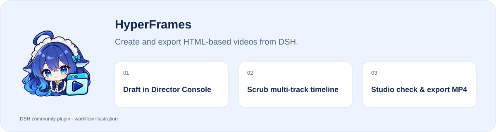
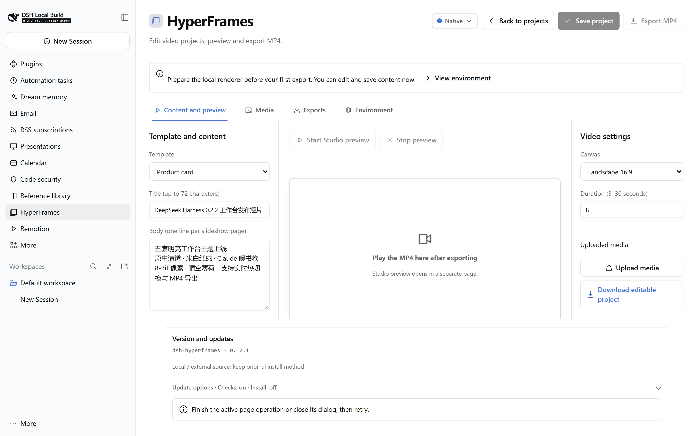

[简体中文](README.md) · **English**

# HyperFrames

**Create and export HTML-based videos in DeepSeek Harness with the OP-DSH Hardware Multi-Track Director Console, 13 bright themes, and 8 dual-layer fonts.**

[](https://www.npmjs.com/package/dsh-hyperframes) [](https://www.npmjs.com/package/dsh-hyperframes) [](https://www.npmjs.com/package/dsh-hyperframes)

**[Install](#install) · [Workflow](#start-using-it) · [Full guide](https://github.com/STARDUSTLC666/dsh-hyperframes/blob/master/docs/REFERENCE.en.md)**

<picture>
  <source media="(prefers-color-scheme: dark) and (max-width: 640px)" srcset="https://raw.githubusercontent.com/STARDUSTLC666/dsh-hyperframes/master/docs/assets/intro/workflow-en-mobile-dark.svg">
  <source media="(max-width: 640px)" srcset="https://raw.githubusercontent.com/STARDUSTLC666/dsh-hyperframes/master/docs/assets/intro/workflow-en-mobile-light.svg">
  <source media="(prefers-color-scheme: dark)" srcset="https://raw.githubusercontent.com/STARDUSTLC666/dsh-hyperframes/master/docs/assets/intro/workflow-en-dark.svg">
  
</picture>

## Features

- **OP-DSH Multi-Track Hardware Director Console (default)**: Recessed dark-bezel Live Stage Monitor (`16:9` / `9:16` / `1:1`, live `TC` timecode & clickable 24-LED Render Matrix), tactile right parameter strip (mechanical aspect keys, template pills, 3–30s duration slider & inline script editor), and full-width scrubbable Video / Caption / Pace timeline deck with vermilion `▶ Play` key — plus 1-click toggle to classic **Form** mode.
- Start from title, product or slideshow templates, upload local media and reorder slideshow images.
- Use official Studio preview and local MP4 rendering while preserving editable project backups.
- Adapted for DeepSeek Harness `>=0.2.2-rc.3` with 13 switchable bright studio themes and 8 Chinese+Latin font pairings (default: YouYuan Mono).

<details>
<summary>See an example</summary>



Captured in a local DeepSeek Harness environment with synthetic sample project data.

</details>

## Install

Open **Plugins** in the DSH desktop app and install `dsh-hyperframes`. If the CLI is available:

```bash
dsh plugin --profile desktop add dsh-hyperframes
```

For the web profile, replace `desktop` with `web`. Restart that DSH profile after installation. The package’s DSH requirement is `>=0.2.2-rc.3`.

## Start using it

1. **Create or open a project**: Open HyperFrames in the sidebar and click **New video** or open an existing project to land in the **OP-DSH Director Console** (switch to classic **Form** mode anytime in 1 click).
2. **Direct & scrub scenes live**: Edit the title, press mechanical `16:9 / 9:16 / 1:1` keys, pick templates, drag the 3–30s slider, and expand **Script** for line-by-line scenes; press the vermilion `▶ Play` key or pointer-scrub the Video / Caption / Pace tracks and 24-LED Render Matrix to inspect frame timing live.
3. **Save & organize media**: Save the project before uploading images, audio, or muted video copies; reorder images in **Media** without altering original files.
4. **Prepare renderer & Studio preview**: Prepare the official renderer in **Environment** on first use, then launch official Studio preview to verify final motion.
5. **Export MP4 & keep backups**: Confirm the pre-export summary to render HD MP4 locally, switch the monitor to **MP4** for inline playback/download, and keep editable backups; search, sort, or restore archives anytime.

Example request：

> Create an HTML product video. Confirm the script and structure before previewing and exporting MP4.

## Before you start

Prepare the official rendering environment on first use. Export again after changing a project.

Configuration, detailed tools and troubleshooting: [full reference](https://github.com/STARDUSTLC666/dsh-hyperframes/blob/master/docs/REFERENCE.en.md).

## Plugin updates

Check updates at the bottom of the workbench or native plugin details. Automatic checks are on by default; **automatic installation is off**. You choose whether to install and when to restart. Suite-managed components update with their bundle. [Update behavior](https://github.com/STARDUSTLC666/dsh-hyperframes/blob/master/docs/REFERENCE.en.md).

## Documentation

- [Full usage, configuration and limits](https://github.com/STARDUSTLC666/dsh-hyperframes/blob/master/docs/REFERENCE.en.md)
- [Release notes](https://github.com/STARDUSTLC666/dsh-hyperframes/blob/master/CHANGELOG.md)
- [Validation scope and history](https://github.com/STARDUSTLC666/dsh-hyperframes/blob/master/docs/VALIDATION.md)

## Feedback and contributions

If the plugin helps, a Star makes it easier for others to discover. Report problems or suggest improvements in [Issues](https://github.com/STARDUSTLC666/dsh-hyperframes/issues); code and documentation [PRs](https://github.com/STARDUSTLC666/dsh-hyperframes/pulls) are welcome. Include versions and reproduction steps, and remove credentials from reports.

## License

[MIT](https://github.com/STARDUSTLC666/dsh-hyperframes/blob/master/LICENSE)

<a id="what-it-does"></a>
<a id="requirements-and-configuration"></a>

## Skills and runtime versions

Bundled skills and the managed renderer are pinned to 0.9.77. Nine canonical skills and fourteen compatibility names are registered, including reverse-video and style-sampling workflows. DSH plugin updates own this bundle; existing user projects and lockfiles remain separate. Explicit preparation must finish successfully before preview/render. If an installed npm is invisible to Desktop, check its launch PATH (Homebrew commonly /opt/homebrew/bin or /usr/local/bin), restart DSH and retry. See the [usage guide](docs/USAGE.en.md) and [skill synchronization](docs/SKILL-SYNC.md).
