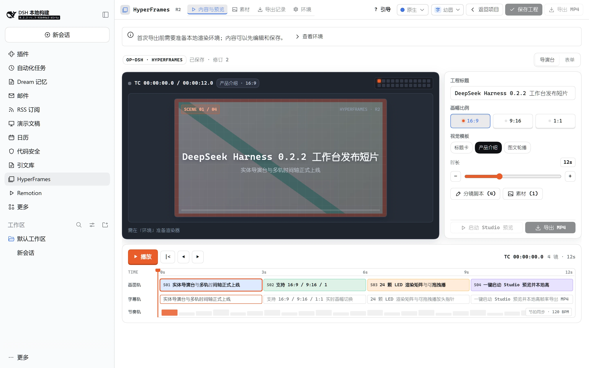

**简体中文** · [English](README.en.md)

# HyperFrames

**在 DeepSeek Harness 中用 HTML 创作并导出视频，内置可切换五套明亮风格的工作台界面。**

[](https://www.npmjs.com/package/dsh-hyperframes) [](https://www.npmjs.com/package/dsh-hyperframes) [](https://www.npmjs.com/package/dsh-hyperframes)

**[安装使用](#安装) · [使用流程](#开始使用) · [完整说明](https://github.com/STARDUSTLC666/dsh-hyperframes/blob/master/docs/REFERENCE.zh.md)**

<picture>
  <source media="(prefers-color-scheme: dark) and (max-width: 640px)" srcset="https://raw.githubusercontent.com/STARDUSTLC666/dsh-hyperframes/master/docs/assets/intro/workflow-zh-mobile-dark.svg">
  <source media="(max-width: 640px)" srcset="https://raw.githubusercontent.com/STARDUSTLC666/dsh-hyperframes/master/docs/assets/intro/workflow-zh-mobile-light.svg">
  <source media="(prefers-color-scheme: dark)" srcset="https://raw.githubusercontent.com/STARDUSTLC666/dsh-hyperframes/master/docs/assets/intro/workflow-zh-dark.svg">
  
</picture>

## 功能

- 从标题卡、产品介绍和图文轮播模板开始。
- 编辑内容、上传素材并调整图片顺序。
- 使用官方预览与本机渲染，保留可编辑工程。
- 适配 DeepSeek Harness `>=0.2.2-rc.3`：工作台与弹窗支持「原生清透 / 米白纸感 / Claude 暖书卷 / 8-Bit 像素 / 晴空薄荷」五套明亮主题切换。

<details>
<summary>查看实际示例</summary>



图片来自本地 DeepSeek Harness 验证环境的示例工程，使用示例内容。

</details>

## 安装

在 DSH 桌面版「插件」面板安装 `dsh-hyperframes`。已配置命令行时也可使用：

```bash
dsh plugin --profile desktop add dsh-hyperframes
```

网页版把 `desktop` 改为 `web`；安装后重启对应的 DSH。宿主要求以包声明 `>=0.2.2-rc.3` 为准。

## 开始使用

1. 从左侧栏打开 HyperFrames，点击“新建视频”，选模板并填写内容。
2. 先保存工程，再上传素材；在“素材”页调整顺序，原始文件保持不变。
3. 首次使用在“环境”页准备渲染环境，等待实际准备完成。
4. 启动预览并检查画面，停止预览后再编辑或导出 MP4。
5. 播放并下载成品；保存可编辑工程备份。以后可在工程库搜索、排序，或从归档恢复。

可以这样说：

> 制作一个 HTML 产品介绍视频，先确认文案与结构，再预览和导出 MP4。

## 开始前要知道

首次使用需准备官方渲染环境；工程修改后需要重新导出。

配置、完整工具与排错见[详细使用说明](https://github.com/STARDUSTLC666/dsh-hyperframes/blob/master/docs/REFERENCE.zh.md)。

## 插件更新

在工作台或原生插件详情页底部检查更新。默认自动检查，**默认不自动安装**；是否安装、何时重启由你决定。Suite 管理的组件随整包更新。[查看更新规则](https://github.com/STARDUSTLC666/dsh-hyperframes/blob/master/docs/REFERENCE.zh.md)。

## 文档

- [详细使用、配置与边界](https://github.com/STARDUSTLC666/dsh-hyperframes/blob/master/docs/REFERENCE.zh.md)
- [更新记录](https://github.com/STARDUSTLC666/dsh-hyperframes/blob/master/CHANGELOG.md)
- [验证范围与历史](https://github.com/STARDUSTLC666/dsh-hyperframes/blob/master/docs/VALIDATION.md)

## 反馈与贡献

如果插件帮到了你，欢迎 Star，让更多人发现它。问题和建议请提交 [Issues](https://github.com/STARDUSTLC666/dsh-hyperframes/issues)，也欢迎代码与文档 [PR](https://github.com/STARDUSTLC666/dsh-hyperframes/pulls)。反馈时附上版本与复现步骤，并移除凭据。

## License

[MIT](https://github.com/STARDUSTLC666/dsh-hyperframes/blob/master/LICENSE)

<a id="依赖与配置"></a>

## 技能与环境版本

内置技能与受管理渲染器固定为 0.9.72；9 个当前技能与 14 个兼容名称均注册，包含视频反推与风格采样。技能通过 DSH 插件更新，已有用户工程及其依赖不会随插件更新被改写。首次显式准备环境后轮询任务，确认真正就绪。桌面已安装 Node/npm 仍报缺失时，检查其启动 PATH；Homebrew ARM 常用 /opt/homebrew/bin，Intel 常用 /usr/local/bin，修改后重启 DSH 再重试。详见[使用说明](docs/USAGE.md)和[技能同步](docs/SKILL-SYNC.md)。
